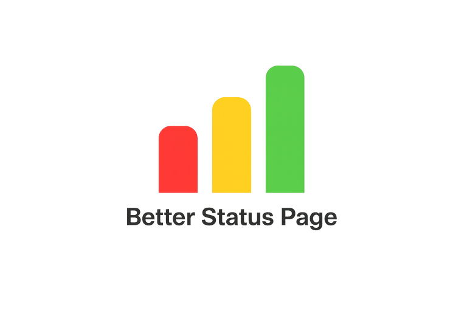

<div align="center">

**English** · [Polski](README.pl.md)

<picture>
  <source media="(prefers-color-scheme: dark)" srcset="apps/status/public/logo_dark.png">
  <source media="(prefers-color-scheme: light)" srcset="apps/status/public/logo_light.png">
  
</picture>

<br />

**A self-hosted status page that doesn't make you cry. 🟢**

*Monitor your services. Alert your team. Keep your users in the loop.*
*No cloud. No subscription. No drama.*

**[🌐 Website](https://betterstatuspage.dev)** · **[🚀 Live demo](https://demo.betterstatuspage.dev/)** · **[📖 Documentation](https://docs.betterstatuspage.dev)**

[](https://nodejs.org)
[](https://typescriptlang.org)
[](https://react.dev)
[](https://fastify.dev)
[](LICENSE)

</div>

---

## The pitch 🎤

You know the drill. Your API goes down at 3 AM, users start tweeting, your boss is calling, and your status page is... a static HTML file someone last updated in 2019 that says "All systems operational" in Comic Sans.

**BetterStatusPage** fixes that. It's a fully self-hosted monitoring and status page platform that runs as a **single Node.js process with zero external dependencies** — no Postgres, no Redis, no Kubernetes, no $200/month SaaS bill. Just clone, configure, deploy. Done.

---

## Release status

BetterStatusPage is currently in beta. The current target is a practical self-hosted deployment for small teams and personal infrastructure:

- one Node.js 26 process,
- SQLite persistence,
- Docker Compose deployment,
- Nginx reverse proxy,
- built-in backups and offline restore,
- no external database, queue, or cache required.

Thank you in advance for your interest in the project and for every installation, test, bug report, and piece of feedback. Early real-world testing is especially valuable and will directly help shape BetterStatusPage on the way to a stable release.

Before exposing a production instance, read the [Deployment](https://docs.betterstatuspage.dev/deployment/) and [Backup and restore](https://docs.betterstatuspage.dev/backup-restore/) guides and the [security policy](https://github.com/BElluu/BetterStatusPage/security/policy).

---

## What it does 🚀

- 🔍 **[Monitors](https://docs.betterstatuspage.dev/monitors/)** — HTTPS (auth flows, TLS expiry warnings), Ping / TCP, DNS, SQL Server, PostgreSQL, MySQL / MariaDB, MongoDB, Oracle, Redis, mail servers (SMTP / IMAP / POP3), SSH, TLS certificates, domain expiry, Docker and passive webhook heartbeats, with dependencies between them
- 🔔 **[Notifications](https://docs.betterstatuspage.dev/notification-channels/)** — email, webhook, [Slack](https://docs.betterstatuspage.dev/slack-integration/), [Discord](https://docs.betterstatuspage.dev/discord-integration/), [Microsoft Teams](https://docs.betterstatuspage.dev/teams-integration/), [Telegram](https://docs.betterstatuspage.dev/telegram-integration/), ntfy and Pushover, with templates and automatic retries
- 🤫 **[Alert hygiene](https://docs.betterstatuspage.dev/alert-hygiene/)** — failure thresholds, quiet hours, rate caps and grouping, so alerts stay switched on
- 🎬 **[Actions](https://docs.betterstatuspage.dev/actions/)** — send an HTTP request when a monitor stays down or comes back up
- 🎨 **[Drag-and-drop page builder](https://docs.betterstatuspage.dev/customizing-the-status-page/)** — layout, branding, dark mode and translations without CSS
- 📢 **[Incidents and maintenance windows](https://docs.betterstatuspage.dev/incidents-and-maintenance/)** — severity, updates, linked monitors, recurring windows
- 📬 **[Subscriptions](https://docs.betterstatuspage.dev/subscriptions/)** — email, webhook, RSS/Atom and a JSON status API for your audience
- 🔒 **[Private status pages](https://docs.betterstatuspage.dev/private-status-page/)** and 🛟 **[static fallback](https://docs.betterstatuspage.dev/static-fallback/)** that keeps the page up when the server is down
- 📊 **[Uptime reports](https://docs.betterstatuspage.dev/reports/)** — any date range, CSV export for SLA reviews
- 🔐 **[Secrets vault](https://docs.betterstatuspage.dev/vault/)** (AES-256-GCM, optional HashiCorp Vault), **[single sign-on](https://docs.betterstatuspage.dev/single-sign-on/)** with OpenID Connect, **[users, roles and 2FA](https://docs.betterstatuspage.dev/users-and-roles/)**, and an audit log of every change
- 🧩 **[API tokens](https://docs.betterstatuspage.dev/api/)**, **[configuration as code](https://docs.betterstatuspage.dev/configuration-as-code/)** (YAML) and **[backup and restore](https://docs.betterstatuspage.dev/backup-restore/)**
- ⚡ **Real time** — status changes reach the admin console and the public page over Server-Sent Events, with no refresh

---

## Quick production start

Docker Compose with the published GHCR image is the recommended deployment path. No clone is needed — the server only needs `docker-compose.yml` and `.env`.

On a Linux server with Docker and Docker Compose v2:

```bash
curl -fsSL https://betterstatuspage.dev/install.sh | sh
```

The script downloads `docker-compose.yml` and `.env.example`, generates `JWT_SECRET` and `VAULT_ENCRYPTION_KEY`, pulls the image and starts the container on `127.0.0.1:3000`. It installs into `/opt/bsp` as root and `~/bsp` otherwise (override with `BSP_DIR`), and is safe to run again: an existing `.env` is never overwritten. Keep a copy of `VAULT_ENCRYPTION_KEY` — backups do not include it.

Prefer to see every step? Do it manually:

```bash
mkdir -p /opt/bsp && cd /opt/bsp
curl -fsSLO https://raw.githubusercontent.com/BElluu/BetterStatusPage/main/docker-compose.yml
curl -fsSL https://raw.githubusercontent.com/BElluu/BetterStatusPage/main/.env.example -o .env
chmod 600 .env
```

Edit `.env` and set at least:

```env
BSP_IMAGE=ghcr.io/belluu/better-status-page:0.7.0
JWT_SECRET=<random 32+ char secret>
VAULT_ENCRYPTION_KEY=<64-char hex key>
```

Generate safe values with `openssl rand -hex 32` (once per secret), then:

```bash
docker compose pull
docker compose up -d
```

Open `http://your-server:3000/admin` for first-run setup. For internet-facing deployments, put Nginx and SSL in front and keep the application port private. Environment variables, Nginx, PM2, the production checklist and firewall settings are in the [deployment guide](https://docs.betterstatuspage.dev/deployment/).

---

## Development

Needs Node.js 26.10+ and npm 11+.

```bash
git clone https://github.com/BElluu/BetterStatusPage.git
cd BetterStatusPage
npm install
npm run dev   # API :3000, admin :5173, status page :5174
```

Architecture, checks (`npm run lint`, `npm run typecheck`, `npm test`, `npm run test:e2e`), project structure and how to contribute are in the [development guide](https://docs.betterstatuspage.dev/development/).

---

## License

MIT — do whatever you want. Just please don't set the status page font to Comic Sans. 😅

---

## ☕ Support

BetterStatusPage is completely free and open source. If you find it useful and want to support continued development, voluntary donations are appreciated but never required!

[](https://buymeacoffee.com/belluu)

Your support helps keep the project alive and motivates continued development — but using BetterStatusPage, testing it, and sharing feedback is support enough!

---

<div align="center">
  <sub>Built with ☕, mild sleep deprivation, and a genuine hatred of status pages that lie.</sub>
</div>
